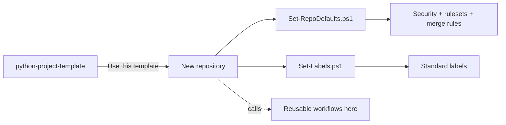

# ⚙️ github-setup

[](https://github.com/FreddiSantos/github-setup/actions/workflows/ci.yml)
[](https://github.com/FreddiSantos/github-setup/actions/workflows/codeql.yml)
[](LICENSE)

Versioned, reproducible configuration for how I work on GitHub: repository defaults, security, labels, reusable workflows and routine automation, applied to every repository I own.

> 🇧🇷 Configuração versionada e reproduzível do meu GitHub. O registro completo, em português, com decisões, como reverter e pendências, está em [SETUP.md](SETUP.md); o resumo está em [RELATORIO-FINAL.md](RELATORIO-FINAL.md).

## What's inside

| Path | Purpose |
|---|---|
| [`bootstrap/bootstrap.ps1`](bootstrap/bootstrap.ps1) | Prepares a Windows machine: installs Git and GitHub CLI, sets a privacy-safe Git identity |
| [`scripts/Set-RepoDefaults.ps1`](scripts/Set-RepoDefaults.ps1) | Security features, read-only Actions token, squash-only merges, auto-merge, `main` ruleset |
| [`scripts/Set-Labels.ps1`](scripts/Set-Labels.ps1) + [`labels/labels.json`](labels/labels.json) | Standard label set (`type:`, `priority:`, `area:`, `status:`) |
| [`scripts/weekly_report.py`](scripts/weekly_report.py) | Weekly activity summary and PR review reminder, published as issues |
| [`.github/workflows/reusable-*.yml`](.github/workflows) | Reusable workflows: stale issues/PRs and Dependabot auto-merge |
| [`templates/workflows/`](templates/workflows) | Small caller workflows copied into each repository |

All scripts are **idempotent**: running them twice leaves the same result.

## How a new repository is set up



```powershell
gh repo create FreddiSantos/<name> --template FreddiSantos/python-project-template --public --clone
powershell -ExecutionPolicy Bypass -File scripts\Set-RepoDefaults.ps1 -Repo FreddiSantos/<name> -AllowActionsPullRequests -RequiredChecks "Lint (pre-commit),Test (Python 3.12),Test (Python 3.13),Build"
powershell -ExecutionPolicy Bypass -File scripts\Set-Labels.ps1 -Repo FreddiSantos/<name>
```

## Routine automation

| Workflow | Schedule (BRT) | What it does |
|---|---|---|
| Weekly summary | Mon 08:00 | Issue with commits, PRs, issues and releases of the week |
| PR review reminder | Wed/Fri 09:00 | Lists PRs open for 3+ days and mentions me |
| Stale (every repo) | daily 07:00 | Warns, then closes inactive issues (60 d) and PRs (30 d) |
| Dependabot auto-merge (every repo) | on PR | Merges minor/patch updates after required checks pass |

## Related

- [python-project-template](https://github.com/FreddiSantos/python-project-template): the template every new project starts from
- [ai-learning-journey](https://github.com/FreddiSantos/ai-learning-journey): my AI learning timeline, built with this setup
- [Project board](https://github.com/users/FreddiSantos/projects/1)

## License

[MIT](LICENSE) © Pedro Freddi
